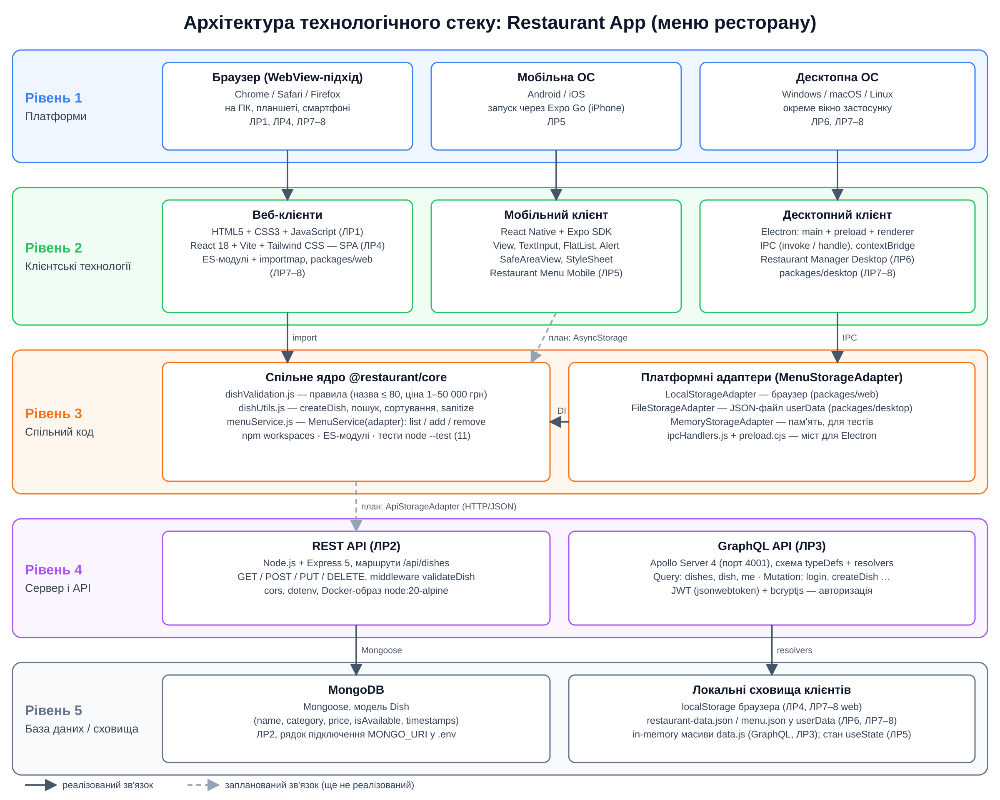

# Restaurant App — меню ресторану на вебі, мобільному й десктопі

Кросплатформний застосунок для ведення меню ресторану: додати страву (назва, ціна, категорія), знайти її за назвою чи категорією, видалити. Проєкт виконано протягом семестру з дисципліни «Крос-платформне програмування» (КНУ ім. Тараса Шевченка, ФІТ).

Цей монорепозиторій (ЛР 7–8) об'єднує спільне ядро й два клієнти. Решта клієнтів і серверів лежать у сусідніх теках репозиторію.

## Швидкий старт

```bash
npm install             # один раз у корені монорепозиторію
npm test                # тести всіх пакетів (18 тестів, fail 0)
npm run start:web       # веб-клієнт → http://localhost:3000
npm run start:desktop   # десктопний клієнт (Electron)
```

## Структура

| Тека | Що всередині |
| --- | --- |
| [`packages/core`](packages/core) | Спільне ядро `@restaurant/core`: валідація, утиліти, `MenuService`, базовий адаптер |
| [`packages/web`](packages/web) | Веб-клієнт: `LocalStorageAdapter`, статичний сервер на `node:http`, importmap |
| [`packages/desktop`](packages/desktop) | Electron-клієнт: `FileStorageAdapter`, `ipcHandlers.js`, `preload.cjs` |

---

## Технологічний стек і компетентності



### Стек за рівнями архітектури

| Рівень | Технології | ЛР | Де в репозиторії |
| --- | --- | --- | --- |
| 1. Платформи | Браузер (WebView-підхід), Android / iOS, Windows / macOS / Linux | 1, 4, 5, 6, 7–8 | — |
| 2. Клієнтські технології | HTML5, CSS3, JavaScript | 1 | [`../lab1`](../lab1), [`../lab1.2`](../lab1.2) |
| | React 18, Vite, Tailwind CSS (SPA) | 4 | [`../lab4.restaurant-spa`](../lab4.restaurant-spa) |
| | React Native, Expo, Expo Go | 5 | [`../lab5.restaurant-app/restaurant-menu-mobile`](../lab5.restaurant-app/restaurant-menu-mobile) |
| | Electron (main / preload / renderer, IPC, contextBridge) | 6, 7–8 | [`../lab6.restaurant-desktop`](../lab6.restaurant-desktop), [`packages/desktop`](packages/desktop) |
| | ES-модулі + importmap | 7–8 | [`packages/web`](packages/web) |
| 3. Спільний код | `@restaurant/core`, патерн «ядро + адаптери», npm workspaces, `node --test` | 7–8 | [`packages/core`](packages/core) |
| 4. Сервер і API | REST: Node.js, Express 5, cors, dotenv, Docker | 2 | [`../lab2.restaurant-server`](../lab2.restaurant-server) |
| | GraphQL: Apollo Server 4, JWT, bcryptjs | 3 | [`../lab3.graphql-restaurant`](../lab3.graphql-restaurant) |
| 5. База даних | MongoDB + Mongoose (модель `Dish`) | 2 | [`../lab2.restaurant-server/models`](../lab2.restaurant-server/models) |
| | localStorage, JSON-файл у `userData`, дані в пам'яті | 4, 6, 3, 7–8 | [`packages/web`](packages/web), [`packages/desktop`](packages/desktop) |

### Сильні моменти проєкту

- **Одне ядро — два клієнти.** Веб і Electron використовують той самий `MenuService` і ті самі правила валідації. Зміна `ERROR_EMPTY_NAME` чи `MAX_DISH_NAME_LENGTH` в ядрі відразу видна в обох клієнтах, а їхній код не змінюється.
- **Безпечний Electron.** `contextIsolation: true`, `nodeIntegration: false`, сторінці відкрито лише 4 функції через `contextBridge`. Типи даних, що надходять із рендер-процесу, перевіряє `ipcHandlers.js`.
- **Тести без браузера і без вікна.** 18 тестів на вбудованому `node --test`. Ядро перевіряється з `MemoryStorageAdapter`, файловий адаптер — у тимчасовій теці ОС, сервер — на захист від шляхів з `..`.
- **Два стилі API.** REST (CRUD страв у MongoDB) і GraphQL (запити, мутації, авторизація через JWT) для однієї предметної області.

### Що я знаю і вмію після курсу

- Порівнювати підходи до кросплатформності (WebView, нативна компіляція, спільний UI) і вибирати підхід під задачу.
- Будувати REST API на Express із валідацією та MongoDB, а також GraphQL API з авторизацією.
- Створювати SPA на React і мобільний застосунок на React Native з тим самим принципом компонентів і стану.
- Робити десктопний застосунок на Electron: розділяти процеси, налаштовувати IPC і безпеку.
- Виносити спільну логіку в окремий пакет, підключати її через адаптери (dependency injection) і покривати тестами.
- Працювати з npm workspaces, ES-модулями, Git/GitHub і Docker.

### Історія проєкту

| | |
| --- | --- |
| **Назва проєкту** | Restaurant App — меню ресторану на вебі, мобільному й десктопі |
| **Проблема** | Персоналу ресторану потрібно швидко вести меню (додавати страви з ціною й категорією, шукати, видаляти) з будь-якого пристрою: з ноутбука адміністратора, з комп'ютера на касі чи з телефона офіціанта. |
| **Моя роль і внесок** | Проєкт виконано самостійно: від макета й вебсторінки до серверів, трьох клієнтів, спільного ядра і тестів. |
| **Обраний стек** | **JavaScript всюди** — одна мова для сервера, вебу, мобільного й десктопу, тому ядро можна перевикористати без переписування. **Express** — мінімальний і зрозумілий фреймворк для REST. **GraphQL** — клієнт сам обирає потрібні поля, зручно для різних екранів. **MongoDB** — документ «страва» природно лягає в JSON. **React / React Native** — один підхід (компоненти + стан) для вебу й мобільного. **Electron** — повторне використання веб-інтерфейсу на десктопі з доступом до файлової системи. **npm workspaces** — монорепозиторій без додаткових інструментів. |
| **Найскладніший кросплатформний виклик і рішення** | Зробити так, щоб одна й та сама логіка працювала в браузері, в Electron і в тестах, хоча кожна платформа зберігає дані по-своєму (localStorage, файл, пам'ять). Рішення — патерн «спільне ядро + адаптери»: `MenuService` отримує адаптер через конструктор і не знає, де лежать дані. Окремо довелося розібратися з модулями: ядро — ES-модулі, тому в браузері воно підключається через importmap, у `main.js` `__dirname` отримується з `import.meta.url`, а preload має бути CommonJS (`preload.cjs`). |
| **Здобуті знання та вміння** | Розумію, як влаштовані веб-, мобільні й десктопні застосунки і чим вони відрізняються. Вмію відокремлювати платформонезалежну логіку від платформної, проєктувати API, налаштовувати безпеку Electron і писати модульні тести для спільного коду. |

---

Репозиторій: [github.com/evgeniaagienko61-tech/restaurant-app](https://github.com/evgeniaagienko61-tech/restaurant-app)
