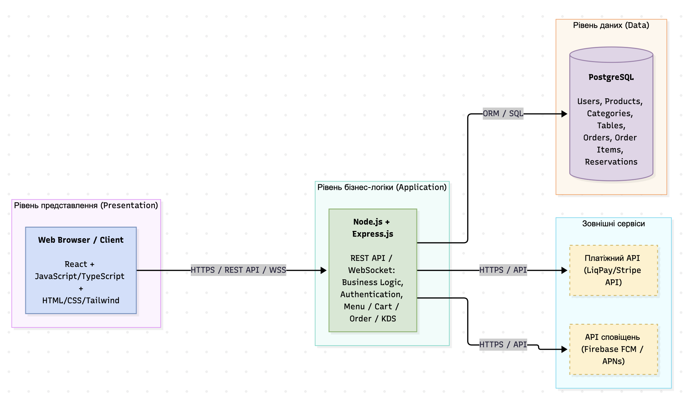
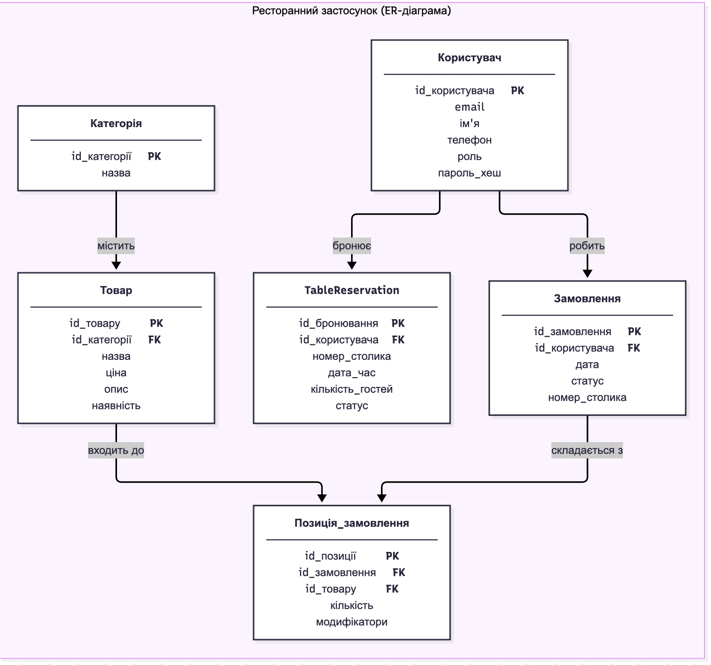
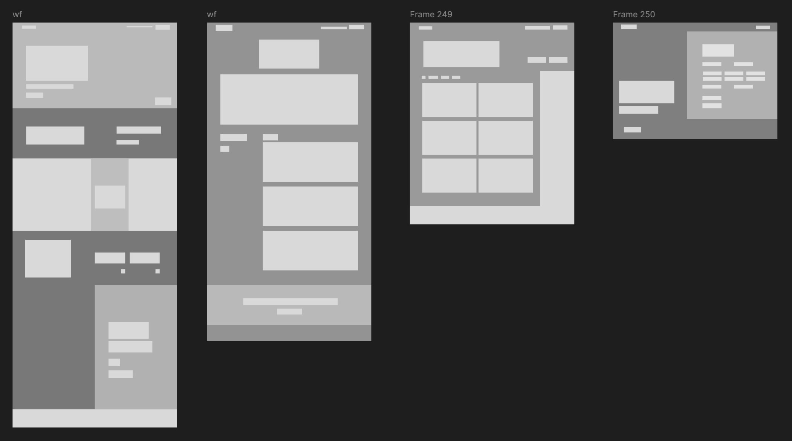
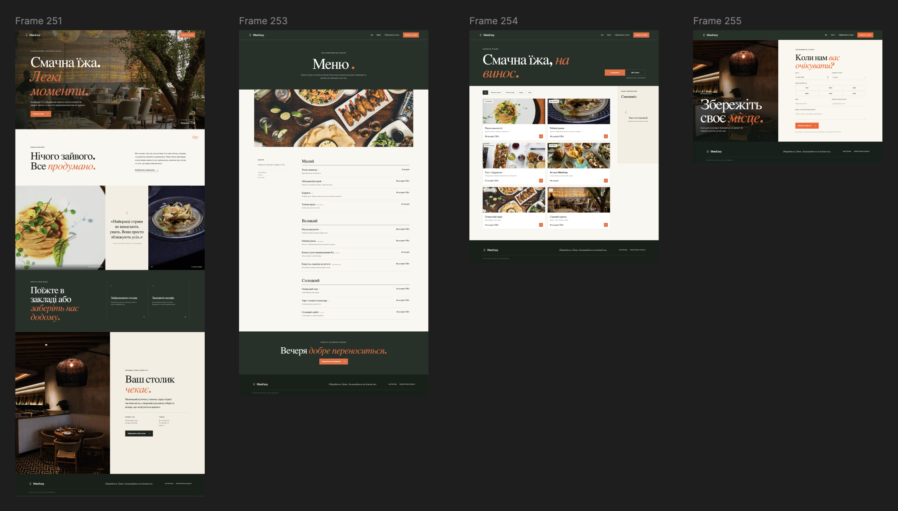

# Матеріали та результати виконання ЛР №3

### Архітектурний стиль та архітектурна діаграма
Обраний архітектурний стиль – трирівнева архітектура (3-tier).

Рівень представлення (клієнтська частина – вебінтерфейс для відвідувачів, клієнтів і адміністраторів ресторану) відповідає лише за відображення даних і збір введення користувача. 
Рівень бізнес-логіки містить усі правила: перегляд меню, фільтрацію страв, додавання страв до кошика, оформлення замовлення, бронювання столиків, зміну статусів замовлень адміністратором і формування звітів. 
Рівень даних відповідає за збереження інформації у реляційній базі даних та взаємодію з нею через чіткий інтерфейс доступу.

### ER-діаграма (Модель даних)
ER-діаграма проєкту відображає сутності реляційної бази даних, необхідні для роботи ресторанного додатку. На ній виділено основні таблиці, такі як користувачі (клієнти та адміністратори), страви (меню), категорії, замовлення та бронювання столиків. Між сутностями встановлено зв'язки (1 до багатьох, багато до багатьох) із чітко визначеними первинними та зовнішніми ключами.

### Каркас і макет UX/UI
Каркаси (wireframes) та візуальні макети (mockups) демонструють інтерфейс користувача для ключових екранів ресторанної системи. Вони забезпечують зручну навігацію для клієнтів під час вибору страв та оформлення замовлень. Макєтування виконано з урахуванням адаптивності та базових принципів ергономіки для вебдодатків.

